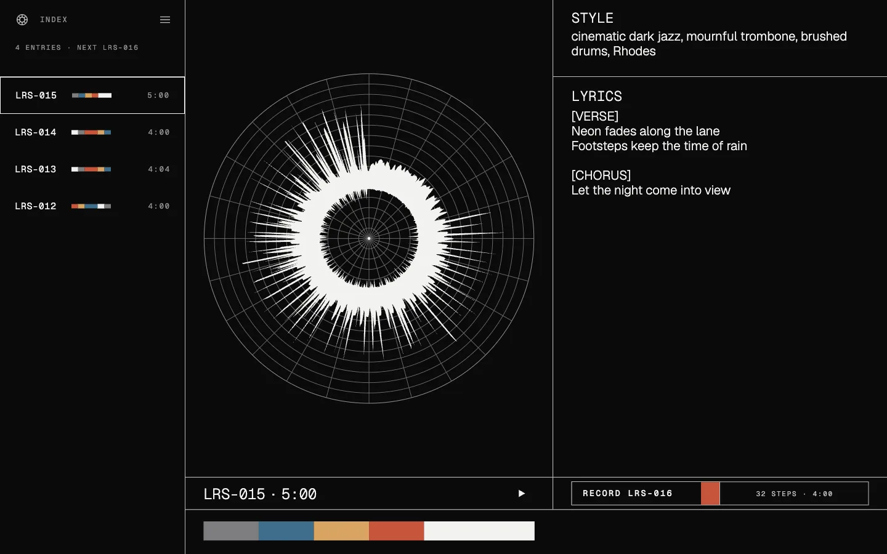
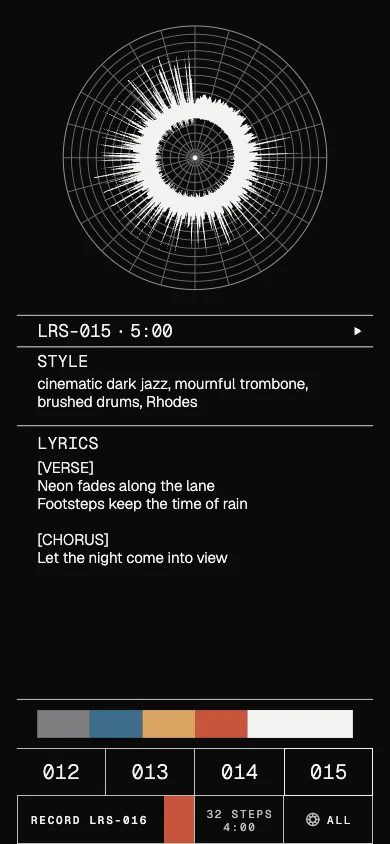
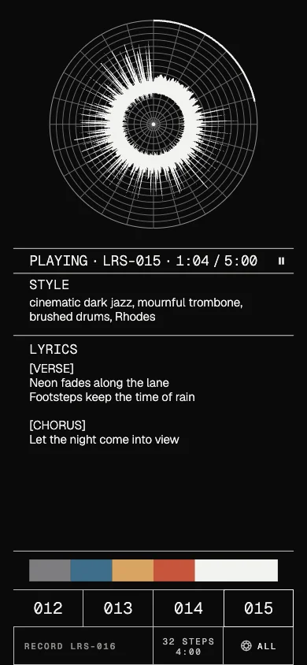
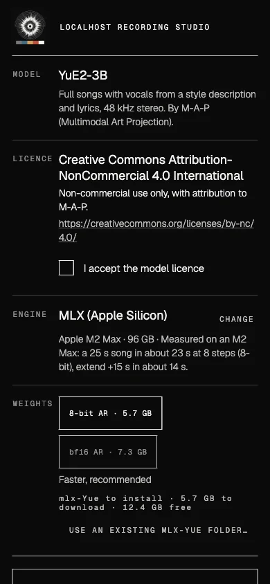

# Localhost Recording Studio

Make full songs from a style description and lyrics on your own hardware: a phone, a foldable,
a Mac or a Linux PC. No server, no account, no upload; after the model download it works offline.

The app is model-agnostic. Models come from a registry (`assets/models/registry.json`) that
declares each model's files, licence, features and limits. The first model is
[YuE2-3B](https://huggingface.co/m-a-p/YuE2-3B) by M-A-P (48 kHz stereo songs with vocals).

What you can do: generate one or several variants, queue work and walk away, play and export,
re-render with another seed or step count, extend a song from any section (chained extends),
reuse a song's prompt for a new take, and rename songs.

Website, with a short ad and a song the app made: **https://jooray.github.io/studio-localhost/**

## Screenshots

<p>
  
</p>
<p>
  
  
  
</p>

## Platforms and engines

The engine is chosen by hardware (you can override it in the model setup):

| Hardware | Engine | Notes |
|---|---|---|
| Apple Silicon Mac | [mlx-Yue](https://github.com/vanch007/mlx-Yue) (MLX) in a Python sidecar | Measured on an M2 Max: a 25 s song in ~23 s at 8 steps (8-bit AR); extend +15 s in ~14 s |
| Linux, Intel Mac | [yue2.cpp](https://github.com/ServeurpersoCom/yue2.cpp) (ggml: CUDA, Vulkan, Metal or CPU) via the same sidecar | built locally by the setup flow |
| Android (arm64, Android 14+) | yue2.cpp in-process (JNI, CPU) in a foreground service | jobs run in the background and resume after being killed |

## Models and licences

The app is free software under the [MIT licence](LICENSE). Each model has its own licence,
shown in the model setup and accepted before anything is downloaded; every song records the
model and licence it was made with. **YuE2-3B weights are CC BY-NC 4.0 (non-commercial use,
attribution to M-A-P).** Third-party code is listed in [THIRD_PARTY.md](THIRD_PARTY.md).

Download sizes: about 3.5 GB on Android (Q6_K GGUF + VAE), about 6 GB on Apple Silicon (8-bit
MLX), 3.2–4.3 GB for GGUF on Linux.

## Install

- **Android:** [Zapstore](https://zapstore.dev/apps/io.github.jooray.localhoststudio), or the signed APK from the releases page. arm64-v8a, Android 14+.
- **macOS:** `Localhost Recording Studio.app` (Apple Silicon recommended). Not notarized yet:
  right-click > Open the first time.
- **Linux:** build from source (below).

On first start the app opens the model setup: pick the weights, read and accept the licence,
and it downloads them (and on desktop installs the engine runtime) for you.

## Build from source

Requirements: Flutter 3.47 (Dart 3.13), git with submodules.

```sh
git clone --recurse-submodules https://github.com/jooray/studio-localhost
cd studio-localhost
flutter pub get
flutter test
```

**macOS:** Xcode, then `flutter build macos --release`.
At runtime the setup flow needs `git` and [uv](https://docs.astral.sh/uv/) (installs into
`~/.local/bin`; nothing is installed system-wide). An existing mlx-Yue checkout can be used via
"Use an existing mlx-Yue folder" in the setup, or `STUDIO_MLX_ENGINE_DIR=/path/to/mlx-Yue`.

**Linux:** `flutter build linux --release`. Build dependencies (Debian/Ubuntu names):
`clang cmake ninja-build pkg-config libgtk-3-dev libmpv-dev`. At runtime: `git`, `cmake`, a C++
compiler and `uv` (the setup builds yue2.cpp; CUDA or Vulkan headers are used when present).

**Android:** Android SDK with NDK 28.2.13676358 and CMake 3.22.1, JDK 17 or newer (Android
Studio's JBR works). `flutter build apk --release --target-platform android-arm64`.
The yue2.cpp submodule is patched at build time (`android/patches/yue2-android-hooks.patch`).
Release signing reads `~/.apk-signing-keystore/signing.properties` (or
`STUDIO_SIGNING_PROPERTIES`) with `storeFile`, `storePassword`, `keyAlias`, `keyPassword`;
without it the release build is signed with the debug key.

**Sidecar (desktop engine) by hand:**

```sh
cd sidecar
uv sync --frozen --no-dev              # numpy + soundfile, for the yue2.cpp backend
# MLX: run the sidecar with mlx-Yue's own venv instead
STUDIO_MLX_ENGINE_DIR=/path/to/mlx-Yue python tools/e2e.py /path/to/mlx-Yue/.venv/bin/python /tmp/e2e
```

## Architecture

```
lib/
  core/        no widgets: model registry, engines, library, job queue, setup, settings
    models/      registry.dart (reads assets/models/registry.json)
    engine/      Engine interface; SidecarEngine (desktop), AndroidNativeEngine (channels);
                 engines.dart picks the engine from Hardware
    library/     song.json format, Library (shared by every platform)
    jobs/        JobQueue (persistent queue = songs with status "queued")
    setup/       ModelSetup: the one first-run flow (licence, sizes, engine, download)
  state/       controllers the screens bind to (forms, navigation, library actions)
  ui/          widgets only: adaptive shell (compact / medium / expanded by window width),
               screens, theme
sidecar/studio_engine/   Python sidecar (JSON lines on stdio); yue2/ holds the YuE2 backends
android/app/src/main/
  kotlin/…/    MainActivity (channels), jobs/GenerationService (foreground service, queue,
               resume), models/DownloadService (resumable, SHA-256 checked), yue2/ (JNI adapter)
  cpp/         yue2_jni.cpp, CMakeLists.txt, yue2.cpp submodule
```

Every song is a folder with `song.json` (title, parameters, model and licence, status, timings),
the audio, `tokens.csv` (the model's token stream for the whole timeline), `score.abc` and a
`work/` folder with engine checkpoints. Re-render, resume and extend read only this layout, so
they behave the same on every platform.

Self-test (desktop): `STUDIO_SELFTEST=<report dir> STUDIO_SELFTEST_QUIT=1` runs a short
generate at 8 steps and an extend through the real app path and writes `selftest.json`.

## Credits

- YuE2 model: [M-A-P (Multimodal Art Projection)](https://github.com/multimodal-art-projection/YuE)
- [yue2.cpp](https://github.com/ServeurpersoCom/yue2.cpp) and the GGUF conversions: ServeurpersoCom
- [mlx-Yue](https://github.com/vanch007/mlx-Yue) and the MLX conversions: vanch007
- [ggml](https://github.com/ggml-org/ggml), [MLX](https://github.com/ml-explore/mlx),
  [media_kit](https://github.com/media-kit/media-kit), [Flutter](https://flutter.dev)
